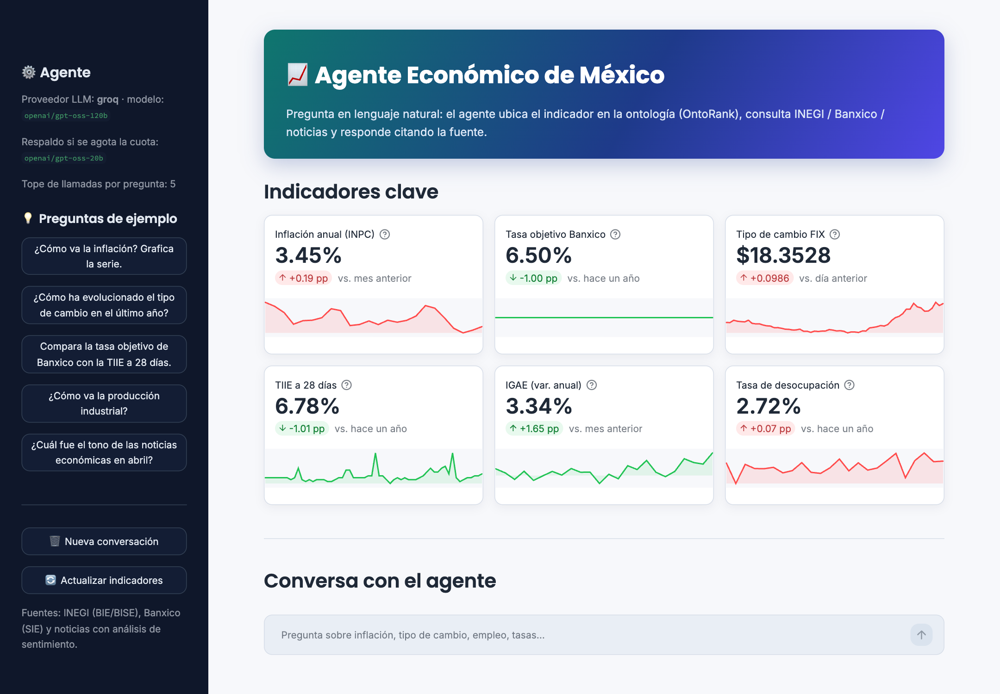
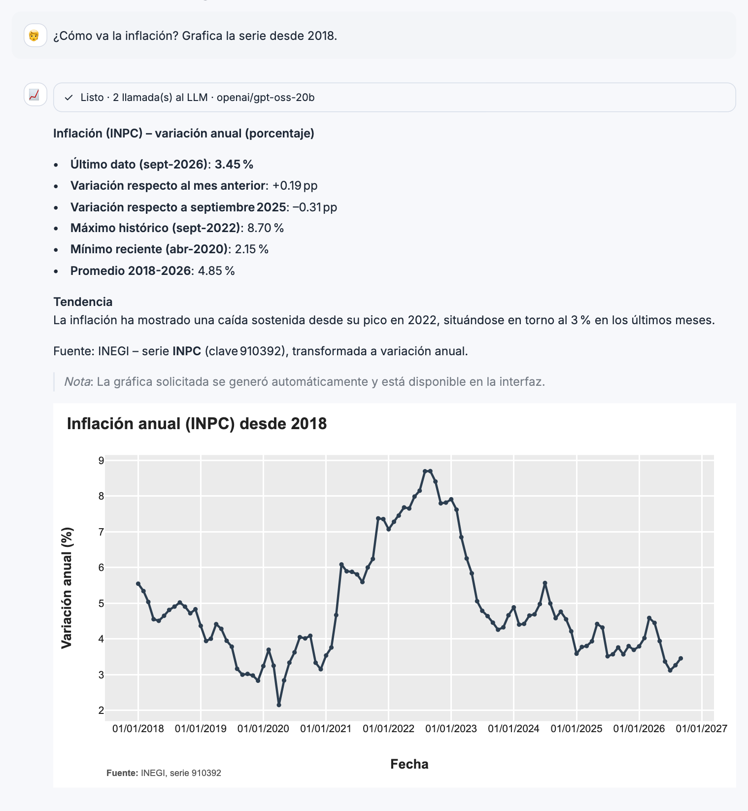
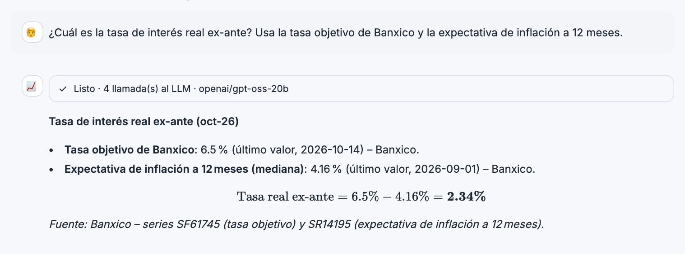
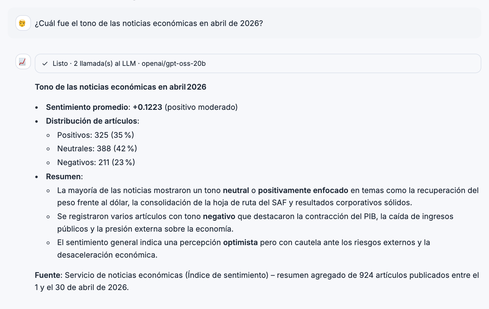
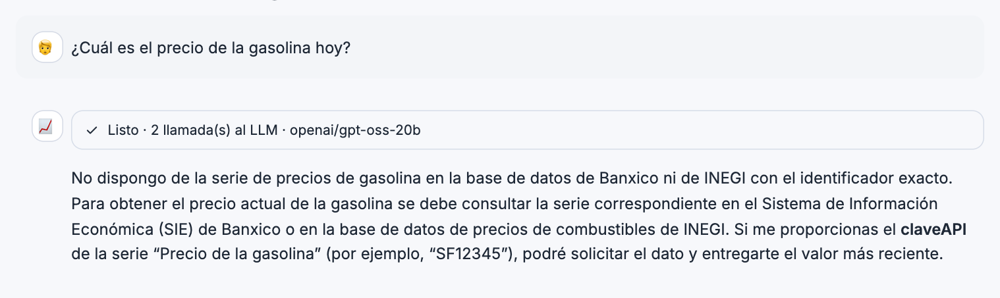

# 📈 Agente Económico de México

Agente conversacional que responde preguntas sobre la economía mexicana en lenguaje natural. Ubica cada pregunta en una **ontología de 66 indicadores** mediante **OntoRank** (un PageRank personalizado con embeddings semánticos), consulta los datos oficiales de **INEGI** y **Banxico** y un índice de **sentimiento de noticias**, y responde citando siempre la fuente, con gráficas cuando aportan.



---

## Ejemplos

### Inflación con gráfica
La inflación se calcula como la variación anual del INPC (no como el nivel del índice) y se grafica en el mismo paso.



### Cálculos combinando series
Tasa de interés real ex-ante a partir de la tasa objetivo de Banxico y la expectativa de inflación a 12 meses; las fórmulas se muestran con LaTeX.



### Sentimiento de noticias por periodo
Tono agregado de las noticias económicas de un mes concreto, calculado sobre todas las notas del periodo.



### Preguntas fuera de alcance
Si el dato no está en la ontología, el agente lo dice en lugar de inventar una cifra.



---

## Cómo funciona

```
Usuario ─► Agente (LangChain create_agent / LangGraph)
             │
             ├─ OntoRank (local, antes de llamar al LLM) ─► indicadores relevantes
             ├─ consultar_inegi      ─► INEGI BIE/BISE
             ├─ consultar_banxico    ─► Banxico SIE
             ├─ consultar_noticias   ─► Google Sheets (sentimiento de noticias)
             ├─ generar_grafica      ─► Plotly
             └─ buscar_indicador_relevante (OntoRank como tool, si hace falta)
```

1. **Ontología** (`ontology/indicadores.ttl`, construida con `rdflib`): 66 indicadores (40 de INEGI y 26 de Banxico) en 13 bloques temáticos —producción, empleo, consumo, vivienda, precios, salarios, expectativas, tasas, dinero y crédito, tipo de cambio, mercado bursátil, sector externo y gobierno—, con su clave de API, unidad, frecuencia, sinónimos y relaciones económicas entre indicadores.
2. **OntoRank**: la pregunta se compara con cada indicador usando embeddings multilingües locales (`sentence-transformers`, sin API key) y el resultado alimenta un PageRank personalizado sobre el grafo de la ontología. Los indicadores mejor rankeados se agregan al contexto de la pregunta.
3. **Tools de datos**: devuelven al LLM un **resumen ya calculado** (último valor, variaciones, máximo/mínimo, últimas observaciones), nunca la serie completa. El modelo cita cifras, no las recalcula.
4. **Respuesta**: el LLM redacta citando fuente, unidad y frecuencia; la interfaz muestra las gráficas interactivas.

### Uso eficiente de los LLM gratuitos
Pensado para los tiers gratuitos de Groq y Gemini:
- OntoRank corre localmente antes de la primera llamada, así que no gasta un turno del modelo.
- Los resúmenes compactos reducen ~250 veces los tokens de una serie diaria (de ~64,000 a ~250).
- Datos y gráfica se piden en una sola llamada (`graficar=True`); una pregunta típica se resuelve en **2 llamadas al LLM**.
- Caché de series por proceso, tope de llamadas por pregunta y **cambio automático** de `gpt-oss-120b` a `gpt-oss-20b` cuando el primero agota su cuota.

---

## Fuentes de datos

| Fuente | Acceso | Qué aporta |
|---|---|---|
| [INEGI – BIE/BISE](https://www.inegi.org.mx/servicios/api_indicadores.html) | API con token | Actividad, empleo, consumo, precios, construcción, sector externo |
| [Banxico – SIE](https://www.banxico.org.mx/SieAPIRest/service/v1/) | API con token | Tasas, tipo de cambio, agregados monetarios, crédito, expectativas |
| Google Sheets | Cuenta de servicio (solo lectura) | Noticias económicas con análisis de sentimiento |

---

## Instalación

Requisitos: Python 3.12 y tokens de INEGI y Banxico, una API key de Groq (o Gemini) y, para las noticias, una cuenta de servicio de Google con acceso de lectura a la hoja.

```bash
conda create -n agente-economico python=3.12
conda activate agente-economico
pip install -r requirements.txt

cp .env.example .env   # y completa los valores
```

Variables principales de `.env` (ver `.env.example`):

| Variable | Descripción |
|---|---|
| `INEGI_TOKEN`, `BANXICO_TOKEN` | Tokens de las APIs de datos |
| `GOOGLE_APPLICATION_CREDENTIALS`, `SHEET_KEY` | JSON de la cuenta de servicio e ID de la hoja de noticias |
| `LLM_PROVIDER` | `groq` (recomendado), `gemini` u `openrouter` |
| `GROQ_API_KEY`, `GROQ_MODEL` | Por defecto `openai/gpt-oss-120b` |
| `GROQ_FALLBACK_MODEL` | Respaldo si se agota la cuota; por defecto `openai/gpt-oss-20b` |
| `MAX_LLM_CALLS`, `SERIES_TTL_HORAS` | Tope de llamadas por pregunta y vigencia de la caché de series |

> Los secretos viven solo en `.env` y `secrets/`, que están en `.gitignore`. Nunca van en el código ni en la imagen Docker.

## Uso

**Interfaz web (Streamlit):**
```bash
streamlit run app.py
```
Abre <http://localhost:8501>.

**Línea de comandos:**
```bash
python -m agent.main "¿Cómo va la inflación?"
```

**Docker:**
```bash
docker compose up --build ui                                # interfaz en http://localhost:8501
docker compose run --rm agente-economico "¿Cómo va el tipo de cambio?"
```
La imagen incluye el modelo de embeddings, así que no se descarga en cada arranque.

---

## Estructura del repositorio

```
├── app.py                    # Interfaz Streamlit (panel de indicadores + chat)
├── agent/
│   ├── main.py               # CLI
│   ├── graph.py              # create_agent, prompt y middleware
│   ├── llm.py                # Factory de LLM (groq | gemini | openrouter)
│   ├── fallback.py           # Cambio de modelo cuando se agota la cuota
│   ├── formato.py            # Fórmulas LaTeX para Streamlit
│   └── tools/                # INEGI, Banxico, noticias, gráficas, OntoRank
├── ontology/
│   ├── build_ontology.py     # Genera indicadores.ttl
│   ├── indicadores.ttl       # Ontología (66 indicadores)
│   └── ontorank.py           # PageRank personalizado con embeddings
├── tests/                    # Tests offline (pytest)
├── Dockerfile, docker-compose.yml
└── .streamlit/config.toml    # Tema de la interfaz
```

Para modificar la ontología (indicadores, relaciones o sinónimos), edita `ontology/build_ontology.py` y regenera el `.ttl`:
```bash
python ontology/build_ontology.py
```

## Desarrollo

```bash
pip install -r requirements-dev.txt
pytest              # 40 tests, sin llamadas a APIs ni al LLM
pre-commit install  # gitleaks y chequeos antes de cada commit
```

El repositorio también corre **gitleaks** en GitHub Actions en cada push.

## Limitaciones

- Los tiers gratuitos tienen cuotas: en Groq, ~200,000 tokens diarios por modelo (unas 40–60 preguntas).
- Las respuestas dependen de las series incluidas en la ontología; el PIB trimestral observado, por ejemplo, no está.
- Las noticias cubren solo el periodo disponible en la hoja de sentimiento.
